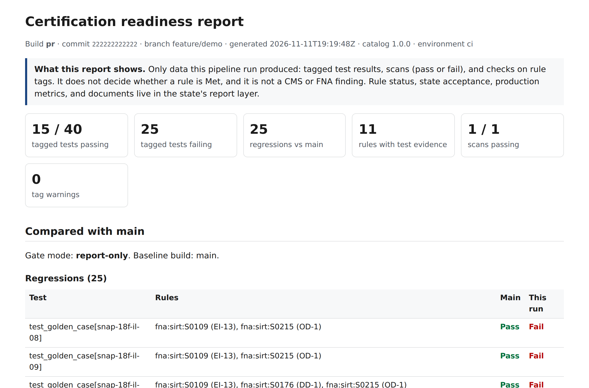
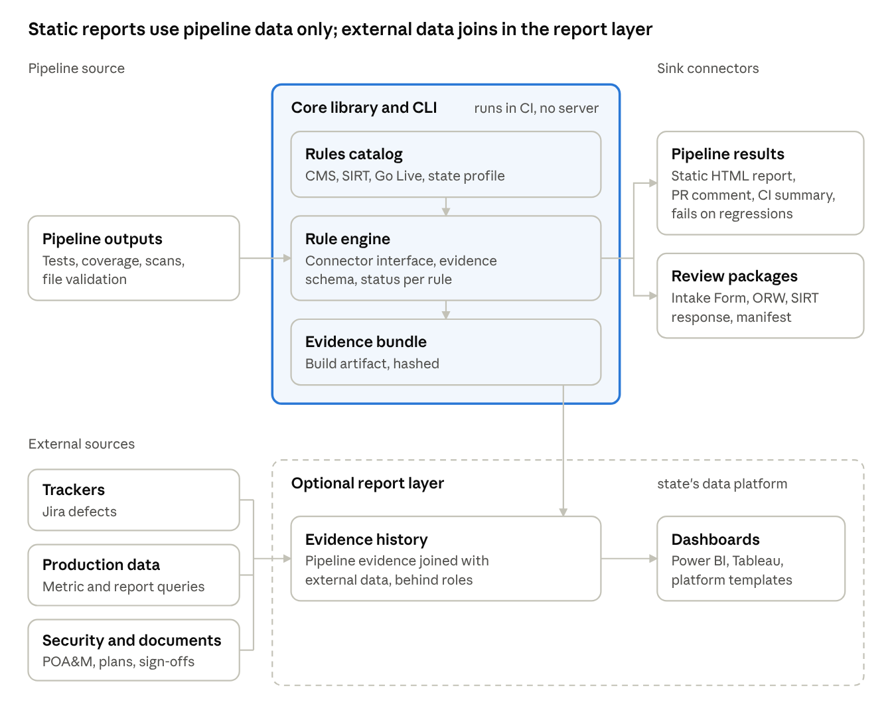

# Continuous APD Certification

**See certification readiness on every build, not at the end of the project.**

States that build Medicaid and SNAP eligibility systems with federal funds must pass CMS Streamlined
Modular Certification (an Operational Readiness Review before go-live and a Certification Review after it)
and FNA's SNAP testing gates (a Complete and Final Test Plan, then Go/No-Go decisions after UAT and after
a live pilot). Most of the evidence those reviews need is produced every day by the vendor's tests and
pipeline, but it is usually gathered by hand weeks before each review.

This toolkit turns the federal rules into checks that run in the vendor's existing CI/CD pipeline, and
gives the state a running view of readiness:

- **For a state Medicaid or SNAP director:** a running, honest view of what is tested, what is missing, and
  what blocks the next review, with no new system to host. → [For states](docs/for-states.md)
- **For a vendor:** one pipeline step. Tag tests with the rules they prove, and the pipeline reports
  certification regressions on every pull request. → [Vendor quickstart](docs/quickstart.md)
- **For a developer:** a documented connector interface and a conformance kit. → [Write a connector](docs/connectors.md)
- **For an analyst:** a report layer of SQL templates and a dashboard that run on the state's existing data
  platform (Snowflake first) or locally on DuckDB. → [Report layer](docs/report-layer.md)

> **Status: MVP.** The catalog, CLI, connectors, static report, report layer, sample system, and templates
> work end to end and are tested. Nothing here is a CMS or FNA product or finding.



## See it in five minutes

```sh
git clone https://github.com/jisaf/continuous-apd-certification && cd continuous-apd-certification
python -m venv .venv && . .venv/bin/activate
pip install -e ".[dev]"

examples/sample-system/run-demo.sh        # a clean main build, then a pull request with a simulated bug
open out/demo/pr/report.html              # the static report (use xdg-open on Linux)

python report-layer/duckdb/build_local.py # the report layer on DuckDB, with sample state data
pip install streamlit
streamlit run report-layer/dashboard/app.py -- --duckdb out/report-layer/cert.duckdb
```

The demo uses the 18F SNAP benefit calculator as a stand-in "state system" and 37 golden test cases
converted from 18F's published scenarios. In the pull request build, the gate catches 25 regressions
caused by the simulated bug. Prefer to look first? Open the saved [pull request report](docs/sample-report/pull-request-build.html)
and the [pull request comment](docs/sample-report/pull-request-comment.md).

## How it works



1. **Rules catalog.** 896 rules with stable keys: 27 CMS E&E outcomes, 22 Conditions for Enhanced Funding,
   821 SNAP System Integrity Review Tool rows, and 26 SNAP Go Live criteria. Each rule records its source,
   gates, evidence kinds, responsibility, and coverage. Keys look like `cms:ee:EE21` or `fna:sirt:S0215`.
2. **Tags.** Tests name the rules they prove: `@rule:fna:sirt:S0215` in Gherkin, `@pytest.mark.rule(...)` in
   pytest, a test category in .NET, or a sidecar file.
3. **Pipeline step.** `capd run` reads the test and scan reports, writes a hashed evidence bundle, lints the
   tags, compares with the last build on main, writes a static HTML report, and publishes a pull request
   comment (GitHub or Azure DevOps), Jira gate issues, and a chat digest. It fails a build only on a tagged
   regression, and only when the state and vendor have switched the gate to blocking.
4. **Report layer (optional).** The evidence joins the state's tracked items (letters, plans, assessments),
   acceptance decisions, production metrics, and gate dates on the state's existing data platform. It
   decides rule status (Met, Awaiting acceptance, Not met, and others) and lists gate blockers.

The full design, the federal rules behind it, and the decisions made so far are in the
[proposal](docs/proposal.md).

## What is here

| Path | Contents |
| --- | --- |
| [`src/capd/`](src/capd/) | The core library and `capd` CLI: catalog, schemas, connectors, pull request gate, static report, validators |
| [`src/capd/data/schemas/`](src/capd/data/schemas/) | The integration contract: JSON Schemas for evidence, bundles, catalog rules, test cases, and configuration |
| [`templates/`](templates/) | Azure DevOps and GitHub Actions pipeline templates, and a commented `capd.yaml` |
| [`report-layer/`](report-layer/) | Portable SQL (tables, rule status, blockers, metric queries), Snowflake setup and roles, DuckDB builder, dashboard |
| [`examples/sample-system/`](examples/sample-system/) | The end-to-end demo: a sample system, its adapter, tagged tests, and configuration |
| [`examples/golden-cases/`](examples/golden-cases/) | Golden test cases (household facts in, expected outcome out) |
| [`examples/packs/`](examples/packs/) | Pre-written Gherkin templates: 588 SIRT scenarios and 26 CMS E&E features, already tagged |
| [`examples/connector-template/`](examples/connector-template/) | A complete connector plugin (Visual Studio TRX test results) to copy |
| [`docs/`](docs/) | Guides, the proposal, research, and the [glossary](docs/glossary.md) |
| [`tools/`](tools/) | Scripts that regenerate the catalog, the packs, and the golden cases from their sources |

## Licensing

Fully open source: code under [Apache-2.0](LICENSE); rules data, examples, and documentation under
[CC0](LICENSE-DATA). See [`LICENSING.md`](LICENSING.md), [`NOTICE.md`](NOTICE.md), and [`CONTRIBUTING.md`](CONTRIBUTING.md).

## Disclaimer

An independent project, not affiliated with or endorsed by CMS, USDA, FNA, or any state. Federal guidance
is quoted for convenience; the agencies' published documents are authoritative. A green signal here is a
readiness signal, not a finding; only CMS and FNA make findings. Nothing here is legal advice.
