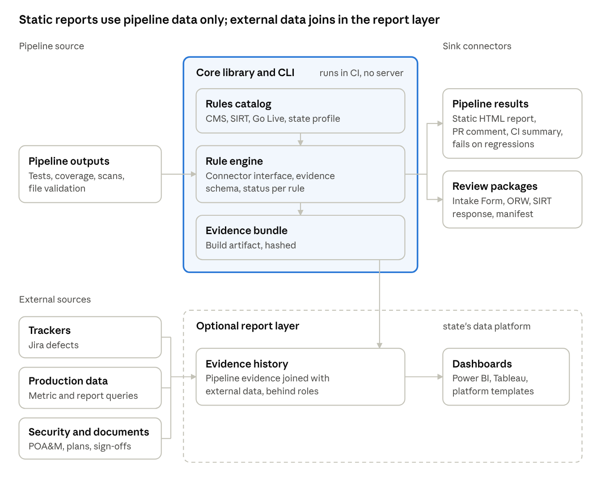
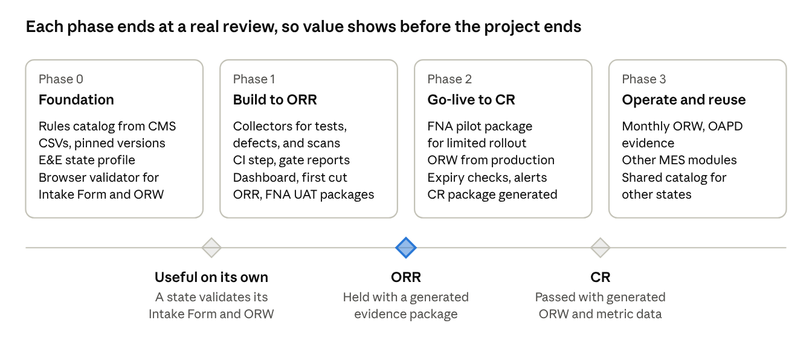

# Continuous Certification for Integrated E&E: A Proposal

Last updated: 2026-11-11. Status: planning.

## Summary

We propose an open, HPT-style toolkit that turns CMS Streamlined Modular Certification (SMC) and FNA SNAP system requirements into checks a vendor runs on every sprint, and a dashboard a state Medicaid director reads at any time. It is modelled on CMS's own [Hospital Price Transparency tool](https://cmsgov.github.io/hpt-tool/): a published, versioned rule set; a validator that runs in the browser or in CI; and plain guidance.

The first target is an integrated eligibility and enrollment (E&E) system that serves Medicaid and SNAP. That is where CMS and FNA rules meet, and where one evidence set can serve both agencies.

The toolkit is a set of independent, additive modules for technical implementers. The main parts are:

1. **Rules catalog** — the 22 Conditions for Enhanced Funding (CEF), the 27 CMS-required E&E outcomes with their default metrics, state-specific outcomes, the SMC required artifacts, and the FNA testing gates and SNAP System Integrity Review Tool (SIRT) items, as versioned machine-readable files built from the [MES Certification Repository](https://cmsgov.github.io/CMCS-DSG-DSS-Certification/).
2. **Evidence ledger** — every test run, metric value, document, and sign-off, linked to the rule it proves, with a date and an owner. It is optional: pipeline-only use keeps the evidence with each build.
3. **Validators and CI plug-ins** — a CLI and pipeline step that fail a build when it breaks a certification metric, and that validate the SMC Intake Form and Operational Report Workbook (ORW).
4. **Director dashboard** — readiness per outcome and per gate (ORR, CR, FNA UAT, FNA pilot), with trends, gaps, and stale evidence.

Expected gains:

- **Visibility:** the director sees certification status every sprint, not at the ORR.
- **Risk:** gaps in tests, metrics, and documents surface months before a review, while they are cheap to fix.
- **Time:** the ORR and CR evidence packages, ORW, and monthly status report are generated from the ledger, not assembled by hand in the last weeks.

## The problem

SMC already asks for continuous oversight, but the tools behind it are spreadsheets and uploads timed to reviews. The [SMC Guidance v2.0](https://www.medicaid.gov/medicaid/data-and-systems/downloads/smc-certification-guidance.pdf) names "continuous oversight of data and evidence" as a goal, requires monthly project status reports during development, and requires monthly metric data in the ORW after go-live. In practice the evidence lives in Excel templates (the SMC Intake Form, the ORW) and is gathered for upload two weeks before each review.

For a state running an integrated E&E project, this causes four problems:

- **The director sees status late.** Monthly status reports describe risks and budget, but not whether each outcome is tested, measured, and evidenced. The first full picture often comes when the vendor assembles the ORR package.
- **Two agencies, two tracks.** CMS gates the module through ORR and CR. FNA gates the same system through the Complete and Final Test Plan, a UAT Go/No-Go, and a pilot Go/No-Go under [7 CFR 277.18](https://www.fna.usda.gov/sso/fr-010214a). Much of the evidence overlaps, but it is usually prepared twice.
- **Evidence goes stale.** Test summaries, defect lists, and metric extracts are snapshots. By the time CMS reads them, the system has changed.
- **Late gaps cost the most.** A missing metric definition found at ORR can push go-live. A metric that cannot be produced from production data can push the CR, and with it the 75% operations match it unlocks.

The vendor's agile process already produces most of the needed signals: tests, defects, builds, and deployments. They are just not linked to the certification rules.

## What the rules require

An integrated E&E module must clear about 58 CMS items and three FNA approval gates. The CMS items are 22 CEF, 27 CMS-required E&E outcomes (plus any state-specific outcomes), and 9 required artifacts. All of them are tracked in the SMC Intake Form from APD approval to the end of the CR.

### CMS: three elements and nine artifacts

- **CEF (22).** From 42 CFR 433.112(b). Most evidence is the APD, contract language, or a state self-attestation. CEF09 and CEF12 need an independent third-party security and privacy assessment (SAR) and penetration test from the last two years. CEF17 needs proof of MAGI functionality through performance testing.
- **E&E outcomes (27).** EE1 to EE27 cover applications, automatic enrollment, MAGI and non-MAGI income rules, electronic verification, timely determinations, notices, MMIS enrollment, renewals, account transfers with the federal marketplace, accessibility, and appeals. EE21 covers multi-benefit applications in integrated systems: the system must pend one program without holding up the others.
- **Metrics.** Each outcome has default metrics. A row-by-row review (below) found that 26 of the 27 E&E outcomes can be shown with automated tests at the ORR, and 20 rest on production data metrics at the CR. For E&E, examples are the share of fully automated determinations (EE5), the share of ex parte renewals (EE13), and test results for the eligibility hierarchy (EE15).
- **Required artifacts (9).** Certification Request Letter, System Acceptance Letter, monthly project status reports, Master Test Plan, test summary reports, deployment plan, defect list, risk list, issue list. Five of these come from tools the vendor already runs.

### The review gates

| Gate | Agency | When | What must be ready | Source |
| --- | --- | --- | --- | --- |
| APD approval | CMS and FNA | Before procurement | One combined APD, submitted separately to each funding agency; CEF, outcomes, and metrics; draft Intake Form and ORW metric definitions; a preliminary test plan in the FNA Implementation APD | [SMC Guidance §4](https://www.medicaid.gov/medicaid/data-and-systems/downloads/smc-certification-guidance.pdf); [HB 901 §3, §6.1](https://www.usda.gov/sites/default/files/guidance-documents/fns-handbook901-version2.5.pdf) |
| Complete and Final Test Plan | FNA | Before UAT starts; UAT must not begin until it is submitted | Milestones, resources, roles, test approach, items to be tested, rollback plan, risks, security, load testing, data conversion, Go/No-Go criteria, and SIRT results. FNA reviews it but does not formally approve it | [HB 901 §6.1](https://www.usda.gov/sites/default/files/guidance-documents/fns-handbook901-version2.5.pdf) |
| ORR entry criteria | CMS | Up to 3 months before ORR | Go-live date and go/no-go criteria, UAT completion date, draft Intake Form, SAR and pen test (or timeline), POA&M, and for E&E the Authority to Connect to the CMS Hub | [Development page](https://cmsgov.github.io/CMCS-DSG-DSS-Certification/SMC%20Process/Development/) |
| ORR | CMS | Before go-live, after most UAT | Unredacted evidence, artifacts, Intake Form, ORW, agenda, and presentation uploaded 2 weeks before | [SMC Guidance §5.1](https://www.medicaid.gov/medicaid/data-and-systems/downloads/smc-certification-guidance.pdf) |
| UAT Go/No-Go | FNA | After UAT, before the pilot | Go/No-Go document: UAT results against expected results, criteria, and metrics; failures by severity; open risks. FNA concurrence is needed to fund the pilot. FNA may also run a System Functional Requirements Review of the UAT or pilot documents (HB 901 §7.5.2) | [HB 901 §6.4.7, §6.7.2](https://www.usda.gov/sites/default/files/guidance-documents/fns-handbook901-version2.5.pdf) |
| Pilot Go/No-Go | FNA | After a live pilot, usually at least 3 months, with a full caseload in the pilot area | Pilot report: cases processed; defects by severity going in, new, resolved, and open; conversion results; interface partner sign-off. FNA approval is needed for statewide rollout | [HB 901 §6.7.3](https://www.usda.gov/sites/default/files/guidance-documents/fns-handbook901-version2.5.pdf) |
| CR | CMS | At least 6 months after go-live | Metric data from go-live to the last month end, SAR within 2 years, POA&M, Certification Request Letter, System Acceptance Letter, T-MSIS compliance | [Production page](https://cmsgov.github.io/CMCS-DSG-DSS-Certification/SMC%20Process/Production/) |
| Operations | CMS and FNA | After CR and rollout | CMS: monthly ORW and an Operational APD. FNA: no monthly metric reporting, but a written security review summary at least every two years (7 CFR 277.18(m)(3)), an optional post-implementation review about 6 months after rollout, a possible SIRT review once statewide, a final APD Update before closure, and a new Implementation APD for major new functionality | [SMC Guidance §6.1.1](https://www.medicaid.gov/medicaid/data-and-systems/downloads/smc-certification-guidance.pdf); [HB 901 §6.10](https://www.usda.gov/sites/default/files/guidance-documents/fns-handbook901-version2.5.pdf) |

Two more dates recur: the APD Update is due to FNA 60 days before the approval anniversary, and FNA prior approval applies to procurements over $6 million and to contract amendments past 20% of base cost.

CMS is also changing its templates. [SHO letter #25-003](https://www.medicaid.gov/federal-policy-guidance/downloads/sho25003.pdf) (August 6, 2025) issues new MES templates, including the APD, Operational APD, an updated ORW, the Analysis of Alternatives, the project status report, an RFP checklist, and an SMC Intake Form that now covers EVV. States must move to them within 6 months of Paperwork Reduction Act approval. It restates monthly ORW reporting from go-live and warns that states that do not report "could lose enhanced Medicaid FFP". It also describes SMC as emphasizing "metric data and operational reporting rather than checklists", which is the premise of this toolkit. For the design, this means the generators must track template versions and fill whichever version the agency currently requires.

### FNA: SIRT and the Go Live Requirements

FNA publishes two checklists that turn its gates into concrete items. Both fit the rules catalog directly.

- **[SNAP System Integrity Review Tool (SIRT)](https://www.fna.usda.gov/snap/system-integrity-review-tool).** 821 yes/no items across eligibility and benefits, changes, claims, notices, system operations, reporting, data matching, and issuance. Each item has an ID and a 7 CFR citation; 72 are marked best practice. FNA publishes it as PDF, Word, and Excel, so it can be loaded as data. Its introduction says it "should be used during system planning and development", before UAT, and in post-implementation reviews. IDs repeat (524 unique IDs for 821 items; `MC-1` appears 12 times), so the catalog needs its own stable keys for SIRT items.
- **[SNAP Eligibility System Go Live Requirements](https://www.fna.usda.gov/sso/snap-eligibility-system-golive-requirements)** (December 2023). 26 criteria to move from UAT to pilot and from pilot to statewide rollout. About half are measurable from system data:
  - Timeliness: legacy data showing 95% of cases processed within 7 or 30 days, and a plan to hold that level through UAT, pilot, and rollout.
  - Reports: eight reports (including FNS-388, FNS-388A, SF-425/FNS-778, timeliness, backlog, notice, and daily activity) produced on demand and accurate 95% of the time.
  - Quality control: at least 2 months of valid QC samples pulled from pilot cases, and at least 1 month reviewed for payment accuracy.
  - Notices: the percent of accurate client notices in the pilot area.
  - Defects: outstanding defects by severity, for example no outstanding critical defects, and a tested workaround for any open defect that affects SNAP eligibility.
  - Conversion: conversion rate against a minimum threshold, and the clean-up workload.
  - Dates and documents: Major Change notification to FNA 120 days before implementation (7 CFR 272.15); contingency, escalation, communication, and training plans; interface partner attestations and an EBT processor letter; QA or IV&V ratings.

The SIRT's testing appendix also settles what counts as a pilot. The new system must be the system of record in the pilot area. A run where the legacy system still decides eligibility and the new system only repeats the work "does not demonstrate how the new system operates in production and is, therefore, not in compliance with the regulation." Running the legacy system alongside a live pilot to compare results is still encouraged ([HB 901 §6.7.3](https://www.usda.gov/sites/default/files/guidance-documents/fns-handbook901-version2.5.pdf)).

### How much can be automated

Most SNAP functional checks and most E&E outcomes can come from the vendor's pipeline and production data; most CEF and Go Live items cannot. Each item was classified by the evidence that best proves it, reading the text of every row.

| Rule set | Items | Automated test | Data metric or report | Document | Outside party | Manual test or demo |
| --- | --- | --- | --- | --- | --- | --- |
| E&E outcomes at ORR | 27 | 26 | 0 | 0 | 0 | 1 |
| E&E outcomes at CR | 27 | 2 | 20 | 2 | 3 | 0 |
| CEF | 22 | 1 | 4 | 15 | 2 | 0 |
| SNAP SIRT | 821 | 638 | 87 | 71 | 1 | 24 |
| SNAP Go Live | 26 | 2 | 9 | 11 | 3 | 1 |

Notes: 19 E&E outcomes are an automated test at the ORR and a data metric at the CR. The three outside-party outcomes rest on PERM results (EE4, EE16) or CMS-side data (EE22). In the SIRT, 588 of 821 rows are good candidates for pre-written example tests; the weakest sections are system performance, policy manuals, waivers, quality control, and reconciliation. The classification is one reviewer's judgment with a 72-row spot check; the row-level files are kept with the project.

### Agile is already allowed

The repository's Development page says that when a state uses agile or a phased approach, the state and its CMS State Officer decide when to hold the ORR and CR, and the state must map each phase to the outcomes it delivers. That mapping is exactly what this toolkit keeps current.

## Prior art

Every part of this toolkit has a working model to copy; what is missing is the link between them and the vendor's pipeline.

| Prior art | What it does | What we reuse |
| --- | --- | --- |
| [CMS Hospital Price Transparency tools](https://cmsgov.github.io/hpt-tool/) | A [GitHub repository](https://github.com/CMSgov/hospital-price-transparency) publishes versioned CSV and JSON schemas, data dictionaries, and examples. An online validator runs in the user's browser for non-technical users; a [CLI validator](https://github.com/CMSgov/hpt-validator-cli) serves technical users and pipelines. A naming wizard and file generator remove format errors. | The whole pattern: a published rule set, one validation engine behind a browser page and a CLI, and helpers that make the required file right the first time. Browser-only validation matters here too, because SMC evidence is unredacted and can hold PHI. |
| [MES Certification Repository](https://cmsgov.github.io/CMCS-DSG-DSS-Certification/) | CMS's source of truth for SMC. Outcomes, default metrics, regulatory sources, and CEF example evidence are published as CSV files; the Intake Form, ORW, status report, and letters as templates. `ORW_Validation.xlsx` lists the ORW field rules. | The rules catalog is generated from these files. The ORW validator implements `ORW_Validation.xlsx` and the [ORW rules page](https://cmsgov.github.io/CMCS-DSG-DSS-Certification/Ongoing%20Reporting/Rules%20and%20Guidelines/) (no added columns, no merged cells, `_YYYY-MM-DD` file names). |
| [MES Certification Navigator](https://github.com/jeff-prov-adv/mes-navigator) | Unofficial. Indexes the repository (132 CMS-required outcomes across 12 modules, 22 CEF, 124 CFR citations) and cross-links MITA 3.0. Content is pinned to a reviewed upstream commit; a weekly job opens a pull request with any CMS changes. | Its extract scripts and its pinning model: rule changes reach a project only through a reviewed version bump, never silently. |
| [MES Testing Guidance Framework](https://www.medicaid.gov/medicaid/data-and-systems/downloads/mes-testing-guidance-framework.pdf) | CMS's testing expectations: test cases traced to requirements, defect severity, automated testing, synthetic test data, and required test metrics (requirement coverage, code coverage, defect age, open and close rates, reopen rates). | The test metrics become standard dashboard tiles. The framework's expectations become rules in the catalog, next to the outcomes. |
| [SNAP System Testing Rule, 7 CFR 277.18](https://www.fna.usda.gov/sso/fr-010214a) and [FNA Handbook 901](https://www.fna.usda.gov/sso/apd/handbook-901) | FNA's testing milestones, Go/No-Go gates, and APD rules for SNAP systems. The handbook points to the SNAP System Integrity Review Tool (SIRT), FNA's checklist of program functions, which FNA uses before and during UAT and the pilot, and possibly after rollout. | The FNA gates become rules with the same structure as the CMS ones, so one ledger serves both agencies. SIRT items become catalog rules, so SIRT results build up sprint by sprint instead of in one pass before UAT. |

One further model, from general knowledge rather than the sources above: NIST's OSCAL format, used by FedRAMP, expresses security controls and assessment results as machine-readable files. It is a good fit for the security side of CEF09 and CEF12, where the third-party assessment and POA&M already follow NIST-based controls.

## Design principles

The toolkit is a set of small tools for technical implementers, each useful alone and more useful together. Four rules shape every part:

1. **Generic and plug-and-play.** The primary user is the vendor or state engineer who wires it into a pipeline. Install is one package or container, configuration is one file, and nothing assumes a particular vendor, cloud, or E&E product.
2. **Independent but additive modules.** The pipeline tools never depend on the dashboard. Pipeline-only use already adds value: certification checks fail the build and evidence is attached to each run. Adding the ledger keeps history across runs; adding the dashboard gives the director a view of it.
3. **Pre-written examples where the test is known.** Where a rule says exactly what to check (a SIRT item, a Go Live report threshold, an ORW field rule), the toolkit ships an example test, metric query, or check that implementers copy and adapt.
4. **Connectors against one core interface.** Every link to an outside tool (GitHub, GitLab, Azure DevOps, Jira, a test runner, a document store) is a connector that implements the same documented interface. Adding one is a documented, tested process, not a change to the core.

### Modules

| Module | Works alone? | What it adds | Depends on |
| --- | --- | --- | --- |
| Rules catalog | Yes | Versioned CMS, SIRT, Go Live, and Testing Guidance rules as data, with a browser for reading them | Nothing |
| File validators | Yes | Checks of the Intake Form, ORW, and SIRT response files, in the browser or CLI | Rules catalog |
| Core library and CLI | Yes | Evidence model, rule engine, connector interface; evaluates rules and writes an evidence bundle and a report for one pipeline run | Rules catalog |
| Connectors | With the core | Read evidence from a source (test reports, trackers, scanners, metric queries) or publish results to a target (pull request comment, CI summary, ledger) | Core interface |
| Example test packs | Yes, as templates | Pre-written Gherkin scenarios, metric queries, and report checks keyed to rule IDs | Rules catalog IDs |
| Package generators | With the core | Filled Intake Form, ORW, SIRT response, Go/No-Go evidence index, upload manifest | Core, catalog |
| Evidence ledger | With the core | History across runs, state acceptance, freshness; kept as a reports branch in git or as tables in the state's Snowflake, with no new server | Core evidence schema |
| Director dashboard | With the ledger | Readiness, trends, alerts, and the views described below; static HTML first, then the state's existing BI tools | Evidence history |

### The connector interface

The core defines two connector kinds and a versioned evidence schema. A sketch, in TypeScript for illustration:

```typescript
interface SourceConnector {
  id: string;                       // "github-actions", "jira", "junit"
  configSchema: JSONSchema;         // validated before any run
  collect(ctx: RunContext): AsyncIterable<Evidence>;
}

interface SinkConnector {
  id: string;                       // "github-pr-comment", "ledger", "azure-devops-summary"
  configSchema: JSONSchema;
  publish(report: RuleReport, ctx: RunContext): Promise<void>;
}

interface Evidence {
  ruleIds: string[];                // "CMS:EE21", "FNA-SIRT:AP-1#3", "FNA-GOLIVE:reports"
  kind: "test" | "metric" | "document" | "attestation" | "assessment";
  result: "pass" | "fail" | "value" | "present";
  value?: number;
  program?: ("medicaid" | "snap")[];
  environment: string;              // "system-test", "uat", "pilot", "production"
  executedBy: "vendor" | "state" | "ivv";
  build: string;
  observedAt: string;
  sourceUri: string;
  sha256?: string;
}
```

Adding a connector follows one documented path: implement the interface, declare its config schema, and pass a shared conformance test suite that runs it against recorded fixtures. Connectors ship as separate packages, so a state can add a Jira or ServiceNow connector without a new core release.

### Pre-written examples

The example packs start where the sources already state the test. The SIRT alone offers 588 rows that a generic scenario plus a thin adapter can cover:

- **SIRT items.** Many items are a single checkable behaviour ("Does the system capture the application date?", AP-1). Each gets a Gherkin scenario with the 7 CFR citation and the rule ID already tagged.
- **CMS E&E outcomes.** Scenarios for outcomes with clear system behaviour, such as EE15 (eligibility hierarchy) and EE21 (pending one program without holding up another).
- **Metric queries.** Reference queries for the default E&E metrics and the Go Live numbers (timeliness, backlog buckets, notice counts), written against a small reference data model.
- **Report checks.** Checks that the Go Live reports can be produced and match source data, with the 95% accuracy threshold built in.
- **File checks.** The ORW field rules from `ORW_Validation.xlsx`, ready to run in CI.

Vendor systems differ, so each example binds to the vendor's system through a thin adapter (step definitions, or a view that maps the vendor's tables to the reference data model). The examples are starting points the state still reviews; they do not replace the state's own test design.

### Mapping is configuration; extension is code

No state will reshape its data for this toolkit, so the toolkit meets each state where it is.

- **Reference implementation.** It covers every tracked item: the 27 E&E outcomes, 22 CEF, all SIRT rows, the 26 Go Live criteria, and the ORW and Intake Form rules. Each item gets the strongest evidence form available: an example test, a metric query, a report check, or a document checklist with an owner and due date.
- **Mapping (configuration).** A state's `mapping.yaml` points each reference entity and field at the state's own tables, views, or SQL expressions, and translates code values. Rule settings are configuration too: N/A with justification, thresholds, state-specific outcomes, Go/No-Go criteria, and which agency template version to fill.
- **Extension (code).** New connectors, new check types, new report formats, and metrics that SQL cannot express are plugin packages written against the core interface.

```yaml
# mapping.yaml (Colorado example, illustrative)
entities:
  application:
    source: snowflake
    table: ANALYTICS.ELIG.APPLICATIONS_V
    fields:
      id: APP_ID
      received_at: "CONVERT_TIMEZONE('America/Denver', SUBMITTED_TS)"
      channel:
        column: SUBMIT_CHANNEL_CD
        values: { WEB: online, PHN: phone, PPR: paper, INP: in_person }
      programs: PROGRAMS_REQUESTED   # array of MA, SNAP, ...
      expedited: EXPEDITED_FLG
rules:
  "CMS:EE12": { applicable: false, justification: "Presumptive eligibility handled in a separate module" }
  "FNA-GOLIVE:timeliness": { threshold: 0.95 }
```

A `check-mapping` command lists unmapped fields and the rules each one blocks, so a state can see what a partial mapping already gives it.

#### Reference entities

The reference model covers every entity the tracked rules need. The first four are built first because they cover timeliness, automation, notices, renewals, and most Go Live numbers.

| Group | Entities | Used by |
| --- | --- | --- |
| First build | Application, Eligibility determination, Notice, Renewal / recertification | EE1, EE5, EE6, EE9, EE13, EE14; Go Live timeliness, backlog, notice, and daily reports; SIRT application and notice items |
| People and case | Person, Household / case, Authorized representative | Most SIRT eligibility items; EE15, EE16 |
| Intake | Program request, Interview, Presumptive eligibility application, Account transfer | EE12, EE22–EE24; SIRT AP items |
| Verification and budget | Verification request, Data source match, Income, Resource, Expense / deduction | EE5, EE7, EE8; SIRT income, resource, deduction, and data match items |
| Decision and benefit | Eligibility group / category, Benefit calculation (SNAP allotment), Coverage / enrollment segment (including transmission to MMIS and MCO assignment) | EE3, EE11, EE15–EE20; SIRT benefit items |
| Ongoing case events | Change or periodic report, Work requirement status (work registration, E&T, ABAWD), Claim and repayment, Benefit restoration, Issuance (EBT), Appeal / fair hearing | EE27; SIRT B, C, F, and work items; FNS-209, FNS-46, FNS-388 |
| Operations | Task / work item, Worker and office, QC sample case, Report run, Disaster SNAP case | Go Live daily and backlog reports, QC sampling; SIRT operations, QC, and D-SNAP items |

## Proposed approach

The toolkit links three things that exist today but are not connected: the published rules, the vendor's delivery signals, and the state's review packages. The state owns the instance and the evidence; the vendor feeds it.



Everything in the core box runs inside a pipeline with no server. The rules decide what each piece of evidence proves, and each run leaves an evidence bundle as a build artifact. The ledger and dashboard are add-ons that read those bundles.

### 1. Rules catalog

One versioned file per rule, generated from the MES Certification Repository CSVs and from the FNA and Testing Guidance sources, then pinned to a reviewed version.

```yaml
id: EE5
title: Electronic Verification
agency: CMS
source: MES Certification Repository, CMS-Required E&E
citations: ["42 CFR 435.940-965"]
gates: [ORR, CR, OPS]
evidence:
  - kind: test        # ORR: functionality built and tested
    gate: ORR
  - kind: metric      # CR and after: measured in production
    gate: [CR, OPS]
    metric: "% of determinations fully automated"
    cadence: monthly
freshness: 30d
```

The citation shown is illustrative; the generator copies the repository's regulatory sources as published. A **state profile** sits on top of the catalog. It adds state-specific outcomes (IDs such as `ST-EE-01`, following the Intake Form convention), marks outcomes N/A with the required justification, and holds the ORW metric definitions. Changes to the profile are reviewed like code, and an outcome change raises a flag that an APD Update is needed.

### 2. Evidence ledger

An optional, append-only record of every piece of evidence across runs: rule ID, kind (test, metric, document, attestation, external assessment), source system, build or release ID, environment, time, owner, and a content hash. Large or sensitive files (SAR, screen prints with PHI) stay in the state's document store; the ledger holds a link and the hash, so it can prove what was submitted without copying it.

Source connectors collect evidence from tools the vendor already runs. The core writes it to a per-run evidence bundle, and the ledger connector stores it when a ledger is in use:

| Signal | Typical source | Feeds |
| --- | --- | --- |
| Test results | JUnit XML, Cucumber, Playwright, test management tools | Outcome tests; test summary reports |
| Defects, risks, issues | Jira or Azure DevOps | Defect, risk, and issue lists; status report |
| Coverage and traceability | Code coverage tools; requirement links | Testing Guidance metrics |
| Accessibility and security scans | Automated 508 checks; vulnerability scans | EE26, CEF12, POA&M |
| Production metrics | Queries against the reporting database | ORW rows; CR metrics |
| Documents and sign-offs | State document store; e-signature | CEF evidence; letters; plans |

### 3. Rule engine and validators

The engine evaluates each rule against the ledger and gives one status: **Met**, **At risk**, **Not met**, **No evidence**, **Stale**, or **N/A (justified)**. Each status carries the reason and the evidence behind it. Validators check the CMS files themselves: the ORW against `ORW_Validation.xlsx`, and the Intake Form against the catalog (every CMS-required outcome and CEF listed, N/A rows justified, evidence file names that exist in the upload set).

### 4. Outputs

- **CLI and pipeline steps** for GitHub Actions, GitLab CI, and Azure DevOps. They write JUnit-style results, so certification checks show up beside normal tests.
- **Browser validator** for state staff, like the HPT online validator: drop in an Intake Form or ORW and get errors, with nothing uploaded.
- **Generated packages**: a filled Intake Form, the ORW, a draft monthly status report, and an ORR or CR upload manifest with the exact file names CMS asks for.
- **Director dashboard**, described below.

### Where the dashboard lives: no new hosting

A hosted app would trigger a security review in every state, so the views are delivered through files and tools the state already approves. Each step adds to the one before.

| Step | How it works | New hosting | History | Who can see it |
| --- | --- | --- | --- | --- |
| 1. Static report per build | Each run writes one self-contained HTML file (no external scripts, no server) and its evidence JSON. The pipeline commits both to a dedicated reports branch or a separate private reports repository, never to the code branch. | None | Latest run, plus links to earlier files | Anyone who can read that repository |
| 2. Git as the ledger | Each run's evidence JSON is a signed commit on a protected reports branch, so the branch is an append-only history. The report generator reads the branch to draw trends. | None | Full | Same as step 1 |
| 3. Snowflake tables | The pipeline also loads the evidence JSON into a certification schema in the state's Snowflake account, next to the metric data it already holds. | None (existing account) | Full, queryable | Snowflake roles mapped to state groups |
| 4. Existing BI tools | Starter dashboards on those tables in Streamlit in Snowflake, Snowsight, Power BI, or Tableau, whichever the state already licenses. The toolkit ships the table schema and templates. | None (existing tools) | Full | The BI tool's own access control |
| Side channels | A Jira sink keeps one Jira issue per rule or gate with its current status, so the director sees certification in Jira dashboards the team already uses. A pipeline digest posts a weekly summary to email or chat. | None | Per tool | Per tool |

Two cautions. Static reports are only as private as the repository, so restricted evidence (security findings, any case data, small-area counts) never goes into them; it stays in Snowflake behind restricted roles, or out of the toolkit. And using existing tools avoids a new system, not data classification: the state still classifies the evidence under its own policy.

### Complete views without exposing sensitive evidence

The views show the status of every item; the details of sensitive items stay where they already live, behind the access controls they already have. Each evidence kind has a class in the catalog, which a state can override in configuration. Anything unclassified is treated as restricted.

| Class | Examples | In repository reports | In Snowflake | Details stay in |
| --- | --- | --- | --- | --- |
| Open | Rule status, test pass counts, coverage, gate dates, document present with date and owner | Yes | Yes | — |
| Summary only | Defects: ID, severity, status, dates, linked rule; no free text | IDs and counts | Yes | Jira, under Jira permissions |
| Restricted | Security assessment findings, penetration test results, POA&M items | Status only: present, dated, expiry date, count of open critical items | Restricted schema, security role only | The security tool or the state's secure document store |
| Aggregate only | Production metrics computed from case data | Values, with counts under 11 suppressed | Aggregates only | The state's governed case data |
| Never collected | Case records, PHI, PII, screenshots with case data | No | No | Source systems |

**Where Snowflake data comes from:**

1. Evidence bundles from the pipeline (open and summary classes), loaded through a stage in the state's cloud storage.
2. Metric and report queries that run inside Snowflake against the state's existing E&E data. Only aggregate results are written to the certification schema; case data never leaves its own schema.
3. Restricted evidence through a separate connector run only by the security role, for example a POA&M export from the security team's tool, loaded into a restricted schema.
4. Defect fields from Jira through the Jira connector.

**How it is secured:**

- Two schemas: `CERT` and `CERT_RESTRICTED`.
- Roles mapped to state groups through single sign-on: viewer (director, project manager, vendor), acceptor (state product owner), security (state security officer), and a write-only loader for the pipeline service identity.
- Secure views show viewers restricted items only as status and counts, for example "3 open critical, oldest 21 days"; the security role sees details. Masking policies cover any free-text column.
- Power BI, Tableau, and Streamlit connect with each person's own identity, so Snowflake roles apply in every tool. There is no shared viewing account.
- Snowflake's access history gives an audit trail.
- The static report generator only renders open and summary classes. This is enforced in code and covered by tests, so a configuration mistake cannot leak restricted fields into the repository.

### Trust and independence

A vendor should not grade its own work. Collectors run in pipelines the state can audit, evidence records are hashed and tied to a build, and some rules need a named state reviewer or IV&V sign-off before they count as Met. The toolkit shows evidence; the state and CMS still judge it.

FNA makes this explicit: the development contractor must not perform UAT and may not take part in the pilot ([HB 901 §6.7.2–6.7.3](https://www.usda.gov/sites/default/files/guidance-documents/fns-handbook901-version2.5.pdf)). The ledger records who ran each test, so UAT and pilot evidence can be shown to come from state testers.

## How a vendor works with it

The vendor's only new habit is tagging: each test, story, and metric query names the rule it proves. Everything else runs in the pipeline they already have.

### In the contract

The Testing Guidance Framework already expects testing requirements in the contract (Test Planning, Expectation 1). The RFP adds one more: the vendor feeds the state's evidence ledger from its pipeline, tags tests to outcome IDs, and delivers ORW metric queries as code. This makes visibility a deliverable, not a favour. FNA's handbook supports the same contract shape: the RFP should require "an incremental system demonstration every few months" (HB 901 §4.6.1), payment should follow state review and acceptance of each major deliverable (§4.7.8), and the same contractor must never "perform the work and then evaluate it" (§4.8.6). The state, QA, or IV&V therefore owns rule thresholds and pass/fail acceptance; the rules and ledger become the machine-readable part of the state's quality assurance plan and requirements traceability.

### Sprint 0

1. Load the rules catalog and write the state profile: state-specific outcomes, N/A justifications, ORW metric definitions.
2. Map each epic or release to the outcomes it delivers. The repository already asks agile states to map phases to outcomes; this keeps that map in the backlog tool, where it stays current.
3. Connect the collectors: test reports, Jira or Azure DevOps, scans, the document store.
4. Write each ORW metric as a query that runs against synthetic data in test environments, as the Testing Guidance Framework recommends (Recommendation 3). A metric that cannot be computed shows up in sprint 1, not at the CR.

### Every story

The Definition of Done adds three checks for any story that touches an outcome:

- Its acceptance tests carry the outcome ID and, for an integrated system, the program: Medicaid, SNAP, or both.
- If it changes data an outcome metric uses, the metric query still runs and its result is in range.
- No new critical vulnerability and no new accessibility failure.

```gherkin
@outcome:EE21 @program:medicaid @program:snap
Scenario: SNAP verification pending does not hold the Medicaid determination
  Given a multi-benefit application for Medicaid and SNAP
  And SNAP income verification is pending
  When the Medicaid determination runs
  Then the applicant receives a Medicaid decision
  And the SNAP case stays pending
```

The same tags work as a pytest marker, a JUnit annotation, or a test-management field.

### Every pipeline run

1. **Pull request:** run the tests, evaluate the rules they touch, and comment the result. A change that turns a Met rule into Not met fails the build, like any other regression.
2. **Merge to main:** write the evidence to the ledger with the build ID.
3. **Nightly:** run scans and metric queries, and mark evidence that has passed its freshness limit as Stale.
4. **Promotion to UAT or production:** produce a gate report for that environment. It becomes part of the deployment record.

### Every sprint review

The dashboard replaces the status slide. The state product owner reviews new evidence and accepts it or sends it back; acceptance is recorded in the ledger. This is the "thorough independent state review of the test results" the Testing Guidance Framework expects (Test Execution, Expectation 1), done in small pieces.

### Integrated E&E: one evidence set, two agencies

Program tags let one ledger answer both agencies. The FNA UAT package is the UAT evidence tagged SNAP; the CMS ORR package is the same run filtered to Medicaid outcomes. The same tags can feed the cost allocation story in the APD, since they show which work served which program.

HB 901 already allows for this. It says the Complete and Final Test Plan covers a system delivered "in whole or in part (e.g., builds when using Agile)", and that the test timeline needs multiple functional iterations for agile projects. The per-release gate reports supply the results for each iteration.

### Keeping agile inside the approved APD

Two FNA rules limit how far a backlog can move without new approval.

- **One project.** "Incremental efforts which may be under approval thresholds individually, but which support a unified outcome, will be regarded by FNS as a single project, and … a cumulative threshold will apply" (HB 901 §1.5.1.1). Releases cannot be split up to stay under approval thresholds. The APD covers the whole system, budget, and schedule.
- **No retroactive approval.** Changes in cost, scope, schedule, or procurement "must be submitted as an APD Update (APDU) and approved by FNS before new significant costs may be incurred" (§7.4.3.3). "Retroactive approvals are granted only in the most extreme circumstances" (§3), and costs outside the approved APD are at the state's risk until approval.

An APDU As-Needed is required (§3.3.4.3) for a SNAP cost increase over $10 million or 10% of total project cost, whichever is less; a major milestone slip over 120 days; a change in procurement approach or scope; a change in system concept or project scope; a change in cost allocation method; or a change in funding source. It is due as soon as the change is known, and no later than 90 days after it is anticipated (§3.3.4.5). On the CMS side, a change to outcomes or metrics also needs an APD-U.

What this means for an agile project:

- Write APD scope as outcomes and capabilities, not features, so normal backlog reordering stays inside it.
- Tie APD milestones to gates (test plan, UAT, pilot, rollout, ORR, CR), not to sprint dates, with realistic buffer.
- Structure the contract around releases or capabilities; FNA prefers fixed-price contracts (§4.8.1).

The toolkit adds an **APD watch** rule set. The approved APD baseline (milestones, budget, and the list of outcomes and capabilities) goes in configuration, and each run compares it with the backlog and gate forecasts. It warns when a gate forecast moves more than 120 days, when an outcome or capability is added or dropped, or when spend data the state chooses to load approaches the 10% line. That gives the state time to file an APDU before costs are incurred, not after.

## What the director sees

The director answers one question at any time: if the next review were held today, what would fail, and who owns the fix?

These views ship first in the static report per build, and later as dashboards in the state's existing tools (see "Where the dashboard lives").

### Each outcome moves through five stages

The core view is a grid of the 27 E&E outcomes, the 22 CEF, and the state-specific outcomes. Each outcome shows how far its evidence has come:

1. **Planned** — in the APD and Intake Form, with a metric definition.
2. **Built and tested** — tagged tests pass in system testing.
3. **Accepted in UAT** — state testers accepted it; this is ORR evidence.
4. **Measurable** — the metric query runs and returns data in pre-production.
5. **Proven in production** — monthly metric data meets the target; this is CR evidence.

A red cell names its blocker and owner. Most outcomes should reach stage 4 long before the ORR.

### Other views

| View | What it shows | Why the director cares |
| --- | --- | --- |
| Next gate | Rules Met against all rules for the next gate (ORR, FNA UAT, FNA pilot, CR); entry criteria with their due dates (3 months, 4 weeks, and 2 weeks before) | Whether to book the review date or move it |
| Trends by sprint | Rules Met over time; defects by severity; defect age; open and close rates; requirement coverage | Whether the vendor is converging or slipping; these are the test metrics CMS already expects |
| Paperwork tracker | CEF documents, letters, plans, and sign-offs with owner, due date, and status | The half of certification no pipeline can produce |
| Expiry and calendar | SAR and penetration test age against the 2-year limit at the planned review date; Authority to Connect; APD Update due 60 days before the anniversary | Dates that silently block a review |
| Two agencies | The same evidence filtered to CMS gates and to FNA gates | One story told to both funders |
| Change log | Each regression, who caused it, and when it was fixed | Contract oversight with facts, not opinions |

During the FNA pilot, a pilot view tracks the measures HB 901 recommends for the pilot report: cases processed in the new system; defects by severity going in, new, resolved, and open; conversion results; and interface partner sign-off.

### Alerts, not reports

The director and the state project manager get a short alert when something changes state: a Met rule regresses, evidence goes stale, a security assessment will expire before the planned review, or an outcome change needs an APD Update. The Testing Guidance Framework asks states to escalate persistent quality issues and hold vendors accountable (Test Execution, Expectation 6); alerts give that process a trigger.

## Where it cuts risk and time

The largest gains come from finding metric and security gaps early, because those are the gaps that move review dates and, with them, enhanced funding. Each row ties to a step in the sources.

| Opportunity | Step it affects | Today | With the toolkit |
| --- | --- | --- | --- |
| Metrics proven computable before go-live | CR needs metric data from go-live (or the retroactive date) to the last month end; enhanced operations match can be claimed from the first day of the quarter after implementation | A metric that cannot be produced is often found while preparing the CR | Every ORW query runs against synthetic data from sprint 1 and against production from day one, so the CR data set builds itself |
| Review dates booked with confidence | Entry criteria up to 3 months ahead; submit at least 4 weeks ahead to hold a date | The state guesses readiness when it requests a date | The Next gate view shows which entry criteria are met and which are late |
| Upload package generated | Unredacted evidence, artifacts, Intake Form, ORW, agenda, and presentation due 2 weeks before; Intake Form must use the exact uploaded file names | Weeks of collecting files and retyping names | The manifest and the filled Intake Form come from the ledger, with names checked |
| Faster answers to CMS questions | Information Request Listing one week before; action items answered ideally within 24 hours | Staff search for the source of each claim | Each rule links to its evidence, build, and owner |
| Security not a late surprise | SAR and penetration test within 2 years of the review; critical vulnerabilities resolved (or a risk acceptance) before scheduling | Assessment age checked by hand; POA&M kept apart | Expiry is checked against the planned review date; open criticals block the gate view |
| Early CMS feedback | States may share a draft Intake Form for preliminary feedback | Draft is rarely current, so it is shared late | The draft is always current and can go to the State Officer monthly |
| Agile phases mapped to reviews | State and State Officer choose ORR and CR points for phased or agile delivery | The map lives in slides | The map lives in the backlog and the catalog, and shows which outcomes each release completes |
| One evidence set for CMS and FNA | FNA review of the test plan, concurrence on UAT results, and approval of pilot results; CMS ORR and CR | Two packages built from the same work | Program tags filter one ledger into both packages |
| Operations stay certified | Monthly ORW after CR; OAPD attestation of ORW location; CMS may re-review under 42 CFR 433.119 | Monthly manual extracts | ORW generated and validated each month; regressions alert before CMS sees them |
| Vendor accountability | Testing Guidance asks states to triage quality data and, if needed, issue cure notices | Disputes over whose numbers are right | One shared, hashed record of tests, defects, and dates |

### FNA-specific gains

- **Go/No-Go documents built as you go.** HB 901 §6.4.7 asks states to "develop the Go/No-Go document well ahead of the decision date and continually share iterations with FNS". The ledger produces a current draft at any time.
- **No UAT start without the test plan.** UAT must not begin until the Complete and Final Test Plan is submitted, and late submission can delay FNA's review of results. The Next gate view shows the plan as an entry item for UAT.
- **Go/No-Go criteria under change control.** HB 901 requires the state to tell FNA before it changes Go/No-Go criteria. Keeping criteria in the versioned catalog makes each change visible and dated.
- **SIRT done continuously.** SIRT items tested sprint by sprint mean the pre-UAT SIRT pass confirms known results instead of finding gaps.

The Go Live Requirements add a measurable layer. Report accuracy, timeliness, QC sample counts, notice accuracy, and defect counts can all be computed from the ledger and production data, so the director sees the FNA readiness numbers months before the Go/No-Go document is due, not when it is written.

### Leading indicators before certification

Some final measures only exist late: PERM error rates come from a federal sample, SNAP QC needs live pilot cases, and accessibility needs people testing with assistive technology. For these, the toolkit tracks a directional indicator from the first sprint. Indicators are a separate rule type: they show a trend and a warning, and never mark a rule Met.

| Final measure | Leading indicator | How | Limit |
| --- | --- | --- | --- |
| EE26 accessibility | Automated WCAG checks on key pages and full user journeys, every build | axe-core through Playwright, Pa11y CI, or Lighthouse CI | Automated tools find only part of WCAG issues; screen-reader and keyboard testing by people and an accessibility conformance report are still needed |
| EE26 language access | Translation coverage of screens and notice templates; relay and TTY information present on notices | String and template checks in CI | Says nothing about translation quality |
| EE4, EE16 (PERM); SNAP payment accuracy | Pass rate of a golden case suite: policy-authored cases with expected determinations and benefit amounts, run on every build | Rules test suite owned by state policy staff | Shows rule correctness, not caseworker or verification errors |
| Same | Verification completeness: share of determinations with every required verification recorded | Data check on test, then production data | PERM errors often come from missing documentation; this tracks that risk, not the rate |
| Same | Agreement with the legacy system on converted cases | Comparison runs before the pilot (HB 901 §5.4) | Legacy results can be wrong too |
| Same | State quality reviews of samples, then SNAP QC samples from the pilot | Review results loaded as evidence | Small samples early |
| EE5 no-touch, EE13 ex parte | Share of a synthetic population determined or renewed with no manual step | Synthetic cases with stubbed data sources in test | Real data source match rates will differ |
| EE6 and Go Live timeliness | Processing time and queue age in UAT and pilot workloads | Timestamps from test runs | Real staffing drives timeliness |
| EE9 and Go Live notice accuracy | Every notice template matches approved text and contains required elements (dates, appeal rights); reading level | Snapshot and content checks in CI | Print and mail steps need a separate check |
| Go Live reports (95% accuracy) | Each required report reconciled to its source data | Report checks on synthetic data each build | Final check is on pilot data |
| CEF09, CEF12 security | Code, dependency, container, and infrastructure scans; automated web scans | CodeQL, OWASP ZAP, and similar | Does not replace the independent third-party assessment |
| CEF10 modularity | API specifications present and valid; business rules kept outside program code | Structural checks | Structural only |
| CEF15 T-MSIS | Generated T-MSIS files pass published data dictionary and data quality rules | File validation in CI | CMS's own assessment is final |
| Performance (SIRT system items, Go Live) | Response time under load, trended per release | Load tests in the pipeline | Test load is an estimate |

#### The golden case set: seeded from published cases

Several indicators need households with known correct outcomes. No published source gives a ready, licensed, Colorado-specific set, so the set is seeded from existing work and only the gaps are written new. Every expected value is recomputed for current federal rules and Colorado's options, because SNAP rules changed in 2025.

| Source | What it gives | License | How we use it |
| --- | --- | --- | --- |
| CMS PERM eligibility review pilot (2014): 100 test cases with state answer keys, on CMS's login-only state site | MAGI and CHIP outcomes by eligibility group, including mixed households, emergency-only non-citizens, and the adult group | Federal work | Request from HCPF or CMS first; strongest authority |
| [18F SNAP API prototypes](https://github.com/18F/snap-api-prototype) (Python and JavaScript) | 145 Gherkin scenarios with eligibility and benefit amounts: income tests, broad-based categorical eligibility, deductions, utility allowances | U.S. government work, plus CC0 | Copy into the CC0 set; recompute for Colorado and the current fiscal year |
| CMS "Income Eligibility Using MAGI Rules" (2021) | Two fully worked MAGI households, including tax-filer and non-filer rules | Federal work | Copy and adapt to Colorado thresholds |
| HCPF Medical Assistance Renewal Workbook (2025) | Colorado renewal, ex parte, and reinstatement scenarios with outcomes and notices | State work, no public-domain grant | Adapt and cite |
| [PolicyEngine US](https://github.com/PolicyEngine/policyengine-us) | About 2,500 current SNAP, Medicaid, and CHIP tests, some Colorado | AGPL-3.0 | Use as an independent engine to check our cases; do not copy cases |
| MAGI in the Cloud (CMS-funded MAGI engine) | 209 rule-level MAGI tests with reason codes (2014–15 rules) | BSD-3 with notice | Use as a cross-check, or keep in a separate third-party folder with its notice |
| SNAP QC public use file (USDA, FY2024) | 856 reviewed Colorado SNAP households with income, deductions, benefit, and expedited flags | Federal data | Statistical regression check, not hand-checked golden cases |

Gaps that need new cases: SNAP expedited service and its 7-day clock, ABAWD month counting, notice content, SNAP recertification, households with both Medicaid and SNAP outcomes, and Colorado-specific options. Colorado's own system test scripts are not public; ask HCPF and CDHS, or use a Colorado open records request.

### What it does not do

- It does not replace CMS or FNA judgment. Reviewers still rate evidence Satisfactory or Not Satisfactory.
- It does not write the APD, the contract, or the security assessment. It tracks them.
- It must not turn into a checkbox exercise. A rule that is Met on weak evidence is worse than one that is honestly red, so state acceptance is part of Met.

## Roadmap and first project

Build it in four phases, each ending at a real review, and try it first on one integrated E&E project that is still in development.



Phase 0 helps any state on day one, without vendor changes: like the HPT online validator, it checks the Intake Form and ORW in the browser. The first project should be far enough from its ORR that the toolkit can prove itself on that gate. Phase durations depend on the first project's schedule and are left open.

## Decisions so far

| Topic | Decision |
| --- | --- |
| Agency file formats | Output goes in whatever format or template each agency provides (SIRT Excel, Intake Form, ORW, Go/No-Go). The catalog keeps its own stable keys because agency IDs overlap. Assumed acceptable to FNA and CMS; confirm during APD review. |
| FNA pilot | Assumed: a live pilot with the new system as system of record, plus an optional legacy comparison run, meets 7 CFR 277.18. Confirm with FNA. |
| Shared catalog hosting | No CMS or FNA hosting assumed. The core repository is the upstream. |
| First project | Colorado. Full rebuild from scratch by an agile-first civic tech vendor. GitHub for code, Azure DevOps for pipelines, Jira for issues, Snowflake for metrics. First connectors: GitHub, Azure DevOps, Jira, Snowflake. |
| Dashboard and hosting | No dedicated hosted app for now, because it would trigger a state security review. Start with a static HTML report per build, committed to the repository. Then use tools the state already runs (Snowflake, Power BI, Tableau, Jira). A hosted app is paused. |
| Program tags | Used only for the toolkit's own purposes (filtering evidence by agency, gates, and views). Never used for cost allocation. |
| Data model | Fully configurable. A complete reference implementation covers every tracked item; states map their own data to it through configuration, and extend it through code plugins. No state is expected to adopt the reference schema. |
| Language and packaging | Language-neutral contracts (JSON Schema, documented CLI) with one reference implementation shipped as a package and a container image. |
| Catalog maintenance | The core repository owner maintains the upstream catalog. States fork and maintain their own copy, pulling from the core repository or directly from CMS and FNA sources. |
| License | Code: AGPL-3.0, with a commercial license available from the owner. Contributors sign a contributor license agreement so dual licensing stays possible. Rules data and examples: CC0. Agency templates: the new CMS templates from SHO #25-003 are the target. Repository: github.com/jisaf/continuous-apd-certification. |

## Open questions and assumptions

**For CMS and FNA**

- [ ] **Confirm assumptions.** Confirm with FNA and CMS during the first APD review that generated files in their templates are acceptable and that the pilot reading above is right.

**For the state and the first project**

- [ ] **Access and restricted evidence.** Agree which evidence never goes into repository reports (security findings, any case data) and which state roles see it in Snowflake or BI tools.

**For the design**

- [ ] **Reference entity order.** Agree the order of entities for the reference implementation (proposed: Application, Determination, Notice, Renewal first).
- [ ] **License.** Decided: AGPL-3.0 plus commercial for code; CC0 for data and examples. A draft contributor license agreement is in the repository and needs legal review. Constraints: software built with federal funds must be owned by the state, with a royalty-free federal license (HB 901 Appendix A16; CMS CEF05 and CEF06), and FNA warns against accepting free software from a party that would gain an unfair advantage on follow-on work (A16.8). Building the core outside any state contract keeps it the owner's to license; state-funded extensions belong to the state.

**Research still to do**

- [ ] **Evidence-type split.** Done; see "How much can be automated".
- [ ] **Unread sources.** Done for HB 901 chapters 1, 4, 5, 7, and 9 and SHO #25-003; findings are in the gates table, the contract section, and above. Templates: target the new SHO #25-003 templates directly. Golden case sources: researched; see "The golden case set". Next: request the CMS PERM test cases and Colorado answer key from HCPF.

## Sources

All opened on 2026-11-11.

- [Streamlined Modular Certification Guidance, v2.0](https://www.medicaid.gov/medicaid/data-and-systems/downloads/smc-certification-guidance.pdf) — CMS
- [MES Certification Repository](https://cmsgov.github.io/CMCS-DSG-DSS-Certification/) and its [source on GitHub](https://github.com/CMSgov/CMCS-DSG-DSS-Certification) — outcome and CEF CSVs, Development and Production pages, Intake Form guidance, ORW rules
- [MES Testing Guidance Framework](https://www.medicaid.gov/medicaid/data-and-systems/downloads/mes-testing-guidance-framework.pdf) — CMS
- [FNA Handbook and Guidance](https://www.fna.usda.gov/sso/handbook-and-guidance) and [FNA Handbook 901](https://www.fna.usda.gov/sso/apd/handbook-901) — USDA Food and Nutrition Administration; the [full HB 901 v2.5 PDF](https://www.usda.gov/sites/default/files/guidance-documents/fns-handbook901-version2.5.pdf) (683 pages, updated 2025-12-11), chapters 2, 3, 6, and 8
- [SNAP System Integrity Review Tool](https://www.fna.usda.gov/snap/system-integrity-review-tool) (Excel version, PDF dated January 2023) and [SNAP Eligibility System Go Live Requirements](https://www.fna.usda.gov/sites/default/files/resource-files/SNAP-eligibility-go-live-reqs-121523.pdf) (December 2023) — USDA Food and Nutrition Administration
- [State Health Official letter #25-003](https://www.medicaid.gov/federal-policy-guidance/downloads/sho25003.pdf), August 6, 2025 — CMS, new MES templates
- [Final Rule: System Testing](https://www.fna.usda.gov/sso/fr-010214a) and its [synopsis](https://www.fna.usda.gov/sites/default/files/apd/2013-12-5%20Synopsis%20of%20Testing%20Rule%20changes.pdf) — 7 CFR 277.18
- [Hospital Price Transparency tools](https://cmsgov.github.io/hpt-tool/) and [repository](https://github.com/CMSgov/hospital-price-transparency) — CMS
- [MES Certification Navigator](https://github.com/jeff-prov-adv/mes-navigator) — Provenance Advisors, unofficial
