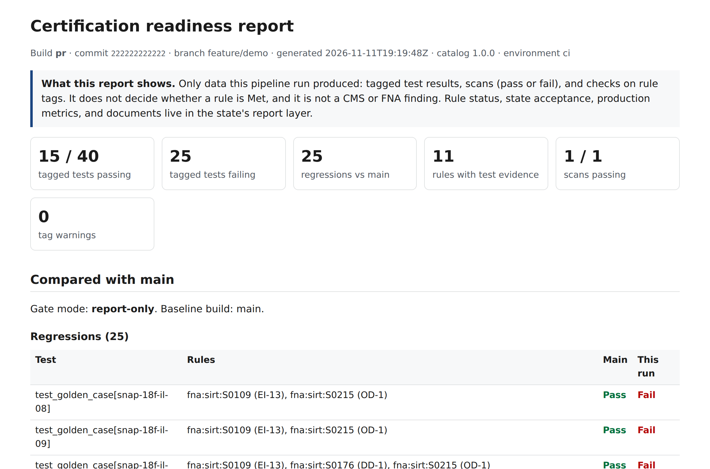

# Reading the static report

Every pipeline run writes one self-contained HTML file, `report.html`. It needs no server and loads
nothing from the internet. Open a saved example: [pull request build](sample-report/pull-request-build.html)
or [main build](sample-report/main-build.html).

## What it is, and what it is not

The report shows **only what this pipeline run produced**: tagged test results, scans (pass or fail), and
checks on rule tags. It does **not** decide whether a rule is Met, and it is **not** a CMS or FNA finding.
Rule status, state acceptance, production metrics, and documents are in the state's
[report layer](report-layer.md).

Whoever can read the repository can read the report. If the repository is public, so is the report, which
is why scans show only pass or fail.

## The sections

| Section | What it tells you | What to do |
| --- | --- | --- |
| **Header** | Build, commit, branch, time, catalog version, environment | Check you are looking at the build you mean |
| **Summary tiles** | Tagged tests passing and failing, regressions against main, rules with test evidence, scans passing, tag warnings | Regressions and tag warnings come first |
| **Compared with main** | Regressions (passed on main, fail now), new failing tagged tests, tests fixed since main, quarantined tests | Fix regressions before merging; the gate blocks on them only in blocking mode |
| **Test evidence by gate** | For each rule set, how many rules that call for automated tests already have a tagged test, plus each tagged rule's latest result | Use the "no tagged test yet" lists to plan test work toward the next gate |
| **Scans** | Each security or accessibility scan, pass or fail | Details are in the scanning tool and the report layer |
| **Tag checks** | Unknown rule keys and untagged tests in tagged paths | Fix tags so evidence counts |

## Common questions

**Why does a rule with passing tests not show as Met?** Met also depends on evidence the pipeline does not
hold: documents, demonstrations, production metrics, and the state's acceptance. That status is in the
report layer.

**Why are so many SIRT rules listed without tests?** The SIRT has 821 rows; 638 call for automated tests.
Coverage grows as features are built. The pre-written packs in [`examples/packs/`](../examples/packs/)
give a tagged starting point for 588 of them.

**A failure is not my change. What now?** If the test flips without a code change, add it to
`quarantine.txt` so it stops blocking, and fix it within two sprints. Reports name rules and tests, never
people.
